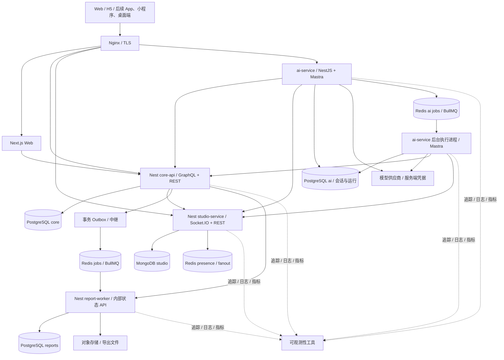

# 面试工坊：产品与架构蓝图

> 状态：五个应用脚手架已安装并完成首次构建与检查；业务和部署尚未实现。具体范围见 status.md，交互草图中的人物、记录、性能数值与运行状态均为示例。
> 目标：以指定技术与工程能力为约束，倒推可用、可解释、可验证的业务需求。从第一阶段预留同一账号的多端使用，客户端按阶段增加。
> 开工依据：[基础边界决策](./decisions/0001-foundation-boundaries.md)、[搭建步骤](./bootstrap-guide.md)；目录职责与目标代码树见 [project-structure.md](./project-structure.md)。

## 1. 产品定位

面向准备前端与全栈岗位的开发者，提供个人训练、多人模拟面试和系统设计实验。用户可以记录回答、接受反馈、安排复习，把设计图、测试结果、性能实验和英文说明整理成可展示的项目档案。扩展目标包含离线练习、浏览器计算与能够调用业务工具的 AI 学习教练。

产品由三条主线组成：

1. **个人训练**：选目标岗位 → 建立计划 → 回答问题 → 自评或互评 → 复习 → 对比进步。
2. **多人面试**：预约 → 邀请 → 进入房间 → 共同看题与画图 → 评分 → 复盘。
3. **工程实验**：设计结构 → 设置模拟条件 → 观察失败与恢复 → 在真实应用实现机制 → 测量 → 写取舍。

开发这个平台本身，再贯穿权限、测试、部署、监控、备份、恢复与英文协作。

### 范围约束

- 最终版本明确包含独立部署的业务服务、Socket.IO 和 3D 实验室；按阶段逐步兑现。
- 覆盖框架的常用核心特性，每项都对应需求、实现和验收，不以调用 API 的数量评分。
- 题库从自己正在学习的少量题目开始，内容随训练增加。
- 早期两人使用即可验证协作；没有真实用户和真实负载时，明确标注测试规模。
- 初期模拟面试采用文字、共同题目、计时和架构画布。音视频属于后续 WebRTC/TURN 专项。
- 公开作品集由用户明确选择内容；回答、聊天和错误日志默认按权限隔离。
- 离线能力采用 Web Worker、Service Worker / Workbox 与 IndexedDB 分工；AI Agent 在后端运行，不以浏览器后台生命周期承载。
- AI 教练采用两步路线：先用 NestJS + 模型 SDK 实现小型 Agent 循环理解原理，正式功能采用 NestJS + Mastra；分基础生成、授权知识检索、工具调用与评测实施，模型供应商和具体模型尚未锁定。
- Web/H5 共用当前 Web 应用；App、小程序和桌面端通过同一身份、权限和业务接口使用数据。React Native、Capacitor、Flutter，小程序框架以及 Electron/Tauri 尚未选定，不提前建立多个空客户端应用。
- 第一版为多端同步、离线草稿与冲突提示。离线范围和协同编辑是独立维度；完整离线业务、多人同时编辑按需求局部升级，不视为自然无成本升级。

## 2. 使用者与权限

| 身份 | 可以做什么 |
| --- | --- |
| 学习者 | 管理自己的计划、回答、复习任务与项目档案 |
| 场次面试官 | 在指定房间切题、启动计时、记录评分；不因此获得对方全部私人资料 |
| 小组管理员 | 管理自己小组的成员、共享题集与预约 |
| 平台维护者 | 管理平台配置、内容和运行状态，敏感操作有审计 |

角色权限之外，必须校验对象所属用户、工作空间和场次。面试官是场次内角色，不能简单成为全站高权限角色。

统一用户、登录身份与设备会话分开建模：同一用户可以绑定经验证的登录方式，每个设备使用独立会话，支持退出当前设备、指定设备或全部设备。Web Cookie 与原生/小程序凭据保存方式可不同，用户身份和授权规则保持一致。已有实时连接、后台任务与 Agent 恢复也需要检查当前权限。

## 3. 页面与交互

### 3.1 学习工作台 `/app`

左侧固定产品导航，主体显示今日待复习、最近回答、当前工程任务和下一场模拟面试。任务项可以直接开始练习。使用 GraphQL 聚合读取，支持有独立错误边界的分区与加载状态。

### 3.2 知识与题库 `/questions`、`/questions/[slug]`

- 公开列表、标签、分页、搜索；筛选条件写入 URL，支持分享和返回恢复。
- 详情包含题干、学习资料、关联知识、题目版本与自己的历史回答。
- 维护者可编辑、预览、发布；旧版本保留，历史回答始终引用具体版本。
- 公开页面练习服务端渲染、元数据和显式缓存失效；个人回答单独按权限获取。

### 3.3 答题与复习 `/app/practice/[id]`

- 左侧题干，主体为回答编辑区，右侧显示参考材料与自测清单。
- 自动保存草稿、恢复未完成内容、提交、自评、他评、重新回答。
- 明确区分草稿、已提交、报告生成中、报告失败、已完成，报告失败不丢失答案。
- 第一版用确定且可解释的复习规则，之后可以比较算法；不先做复杂推荐系统。

### 3.4 模拟面试大厅与房间 `/app/rooms`

- 预约时段、邀请成员、指定场次角色与题集。
- 房间包含参与者、共同题目、服务端计时、文字消息和共享画布。
- 消息显示待确认、已确认、发送失败；刷新或断线后恢复持久状态。
- 第一版画布采用单人编辑锁或版本冲突检测；真正同时编辑再引入 CRDT/OT。
- WebSocket 只提供传输；多人编辑冲突规则、历史恢复和权限需要另外设计。

### 3.5 系统设计实验室 `/app/lab`

中央画布，左侧为节点库，右侧为属性面板，下方为实验时间线。

- 节点：客户端、网关、API 副本、数据库、缓存、队列、Worker。
- 操作：放置、移动、连接、选择、修改参数、撤销重做、保存版本、比较方案。
- 展示：请求路径、缓存命中、队列积压、失败传播和恢复过程。
- 条件：改变输入请求率、处理能力、缓存命中假设、任务耗时，注入模型中的实例失败。
- 3D 采用 Three.js；同一份领域图模型支持 2D 列表或简图，以便低性能设备和键盘使用。
- 渲染对象不进入持久化 JSON；保存稳定节点 ID、坐标、连接、参数、schemaVersion。
- 模拟引擎与渲染分离；较重计算放 Web Worker；支持确定性种子和实验回放。
- Three.js 练习场景/相机、拾取、坐标、实例化、按需渲染、尺寸适配、资源释放与上下文丢失。

**教学模拟必须写明假设。动画与模型数值不证明平台的真实性能。** 真实压测结果来自独立的 k6 等工具，并记录机器、数据规模、并发、预热、版本和测量区间。

### 3.6 小组与项目档案 `/app/groups`、`/portfolio/[slug]`

共享计划、互评任务、设计版本、工程证据、英文 README 与演示说明。支持公开范围和有过期时间的分享。用户可以导出自己的内容。

### 3.7 管理与运行中心 `/ops`

仅维护者可访问。显示失败任务、错误聚合、追踪链接、发布记录、备份与恢复演练记录。尽量接入已有监控工具，不另造整套监控平台。

界面上的“查看恢复演练”读取结果。实际恢复通过受控运维流程操作，避免把覆盖在线数据库包装成随手可点的普通按钮。

### 3.8 离线练习与同步中心 `/app/offline`

用户主动下载有版本的题包；断网时在专用离线练习界面阅读、作答、保存本地草稿，联网后完成鉴权、版本和冲突检查再同步。显示已下载、待同步、同步中、冲突和失败状态。

Service Worker / Workbox 负责明确允许的静态资源与离线入口，IndexedDB 保存题包、草稿和操作队列。不要统一缓存 Next 私人页面、RSC、GraphQL 和登录接口。浏览器可能清理本地存储，重要草稿应及时同步并提供导出。

### 3.9 AI 学习教练 `/app/coach`

工作台侧栏和独立教练页提供流式对话、模拟追问、回答复盘、架构建议与计划草案。用户可查看引用来源、已执行的工具摘要与建议修改的计划差异。

例：用户要求“根据最近练习，安排一次 30 分钟并发专项训练”。Agent 读取授权的答题记录、检索题目与资料，生成练习并追问；更改现有计划前展示草案，用户在产品中确认后，由业务服务校验并执行。

评分是可核查的学习建议，附评价维度、证据和可纠正入口。AI 不替代确定性的权限、计时、事务和测试判定；模型失败时仍可正常作答、自评与复习。

## 4. 技术栈与职责

| 技术 | 明确职责与常用特性 |
| --- | --- |
| Next.js / React | App Router、布局、Server/Client Components、Suspense、错误边界、元数据、公开页缓存、交互组件 |
| TypeScript | 严格类型、联合类型状态机、泛型、类型收窄、接口契约；运行时输入另外校验 |
| Tailwind CSS | Web/H5 的响应式布局、主题、focus/disabled/invalid 等状态、reduced-motion；从平台中立设计令牌映射主题 |
| shadcn/ui | 表单、Dialog、Sheet、Tabs、Combobox、表格、Toast；维护组件接口、键盘与可访问性 |
| Zustand | 画布工具、选中节点、未提交的编辑状态、撤销重做、局部持久化与 selector |
| TanStack Query | 服务端数据缓存、query key、分页、取消、失效、乐观更新、回滚与 hydration |
| Axios | 浏览器 HTTP 传输、错误转换、超时、取消、上传进度、必要的拦截器 |
| Three.js | 实验室图形交互与请求路径展示；不同时再接入 Babylon.js |
| NestJS | 模块与依赖注入、Pipe、Guard、Interceptor、Filter、配置、HTTP、GraphQL、WS 与 Worker |
| PostgreSQL | 强约束业务事实、关联、事务、唯一约束、索引、查询计划和迁移 |
| Prisma | PostgreSQL 模型、迁移、查询与事务；复杂查询与分析仍学习 SQL |
| MongoDB | 协作消息、架构场景文档、版本快照与操作日志；使用 Mongoose 或官方驱动 |
| GraphQL | 客户端组合读取、schema、类型生成、分页、DataLoader、字段和对象权限、复杂度限制 |
| Redis | 热点缓存、限流、在线状态、Socket.IO adapter、BullMQ 的存储基础，区分各自可靠性 |
| Docker | 多阶段构建、最小运行镜像、Compose、健康检查、持久卷、网络与镜像版本 |
| Nginx | 同源入口、TLS、反向代理、WS Upgrade、超时、请求体限制、流式响应与副本路由 |
| Web Worker | 实验室模拟、图布局、题包解析与差异计算；消息协议、进度、取消、过期结果丢弃、Transferable |
| Service Worker / Workbox | 静态资源和离线入口、缓存路由、版本更新；Background Sync 仅作渐进增强 |
| IndexedDB / PWA | 账号隔离的题包、草稿和待同步操作；Manifest、安装体验与存储管理 |
| 模型 SDK / Agent 原理练习 | 在 NestJS 中手写小型模型—工具循环，理解工具结果回传、停止条件、错误与预算 |
| Mastra | 正式 Agent 编排、工具、Memory、Workflow、流式与 AI 观测；通过 Nest Provider 集成 |

### 前端数据边界

- Server Components 直接通过内部 API 访问 Nest，通常使用 Next 的 `fetch`；无需绕自己的 Route Handler。
- 浏览器通过 Axios + Query 处理交互式请求；GraphQL HTTP 请求也可复用这一传输层，无需再同时引入 Apollo Client。
- Axios 不自动获得 Next 扩展 fetch 的缓存语义。公开页显式设置缓存与失效；私人内容明确隔离。
- Query 的远程结果不原样再存一份到 Zustand。Zustand 只保存编辑器和本地界面状态。
- SSR 每个请求独立创建 QueryClient；服务端预取后 hydrate，浏览器复用客户端实例。
- RSC 中不读写跨用户共享的全局 Zustand store。注意客户端 Query 更新不会自动刷新另一个 RSC 内的旧统计。
- Next 负责 Web 表现与适配；核心业务规则在 Nest，后续移动端可复用 API。
- 多端共用契约、内容格式、纯 TS 模型和设计令牌，不假设共用 DOM 或完整 CSS。shadcn 留在 Web；App/小程序/桌面端按运行环境验证组件和传输适配。
- 远程数据缓存、编辑状态、本地待同步操作分别归 Query、局部状态/Zustand、平台存储所有，避免三处同时成为答案的权威版本。
- 不让核心业务只能通过 Next Server Actions 调用。桌面端加载线上 Next 与打包本地前端资产是不同路线；本地资产不自动携带 SSR 等服务端能力，选型前做小型验证。

## 5. 最终部署边界

### core-api：学习业务与客户端聚合入口

拥有用户、登录身份、设备会话、工作空间、成员、题目与版本、训练计划、提交、评分、复习、场次预约、Outbox。使用 PostgreSQL + Prisma。对外提供 GraphQL 查询及 REST 命令；聚合需要时调用其他服务的接口。

当前由 Nginx 提供入口路由，core-api 的 GraphQL 承担工作台等查询聚合；未独立拆出 API 聚合 BFF。此处的“聚合查询”不同于 DDD 聚合根：后者管理单个业务聚合的一致性，当前按实际业务复杂度再建模，不设置统领全部微服务的全局聚合根。跨服务写入与权限仍由业务所属服务负责。

增加客户端不自动新增 BFF；独立网关/BFF 的部署边界仍待评估。先通过统一接口和少量平台适配满足多端，聚合复杂度或客户端差异形成证据后再拆。

### studio-service：实时协作与设计场景

拥有房间消息、画布场景、操作记录、版本快照和实验配置，使用 MongoDB；临时在线状态使用 Redis。通过 core-api 校验房间权限，不直接读核心数据库。权限变更必须使已有连接失效或重新鉴权。

MongoDB 文档具有自然边界，便于练习嵌套文档和版本演进。初期 PostgreSQL JSONB 也能实现场景存储；引入 MongoDB 的决定包含学习目标，不宣称它是唯一方案。

### report-worker：报告与异步处理

拥有任务执行状态、报告、导出结果与消费去重记录，使用独立 PostgreSQL database/schema 和对象存储。通过 BullMQ 接收任务，并提供内部报告状态读取接口。它不直接修改 core-api 的业务表。

这是报告领域的最终独立边界；仅启动一个后台消费进程不等于已经拆出独立业务服务。初期可先划分模块，再逐步启用自己的数据和接口。

### ai-service：学习教练与模型运行

新增扩展服务，拥有会话、AgentRun、工具执行记录、建议草案、用量和评测版本，数据使用独立 PostgreSQL ai database/schema。通过 core-api 和 studio-service 的授权接口访问材料，不直接查询其他服务的表。模型 API 密钥仅在服务端。

已确定正式功能采用 **NestJS + Mastra**：NestJS 管接口、身份、权限、配额、输入校验和业务客户端，Mastra 管 Agent、工具编排、Memory、Workflow 与 AI 运行观测。通过 Nest 自定义 Provider 创建与注入 Mastra，默认同一进程、同一 Docker 镜像内组合，不另外启动独立的 Mastra HTTP 服务。

先作为边界清楚的 Nest 模块实现，随后独立部署为第四个业务微服务；学习教练、模拟面试官和架构评审先作为同一服务中的模式或 Agent。长任务使用 AI 专用队列与后台执行进程，仍属于 ai-service 的领域和数据边界，不算第五个业务微服务。report-worker 仍负责确定性的统计和导出，需要 AI 内容时通过接口获取，不绕过权限读取 AI 会话。

共享的 Mastra Provider 只持有可复用配置与依赖；用户、工作空间、会话、预算与授权范围按每次运行传入并隔离。工具通过授权业务客户端调用 core-api / studio-service，资源所属服务复核权限与版本，模型传入的 userId 不作为可信身份。

BullMQ 负责入队、并发和任务调度；Mastra Workflow 负责步骤、等待确认与继续执行。以 AgentRun 关联 queueJobId 和 workflowRunId，队列重投时继续同一业务运行。明确每层重试范围与总预算，写工具用业务幂等键，避免队列与工作流各自从头重跑造成重复写入。具体恢复能力须在配置持久化存储后验证。

原三个业务服务加上 AI 扩展后，最终为四个独立业务单元，均有构建、部署、配置、鉴权与健康检查。Next、Nginx、数据库容器不作为“业务微服务数量”计算。

学习阶段可共用一台数据库服务器，但使用独立 database/schema、凭据和授权；不跨服务 JOIN 或直接写表。一个 monorepo 不妨碍服务独立部署。

初期先实现边界清晰的 Nest 模块，随后按阶段抽出 studio-service、report-worker 与 ai-service。拆分后要实际验证网络失败与部署独立性。

## 6. 接口与数据契约

### 对外接口分工

- GraphQL：工作台、题目关联信息、小组视图和档案等组合查询。练习 Query、类型生成、分页、DataLoader，按需增加 Mutation 专项。
- REST：登录会话、提交回答、修改计划、创建预约、上传签名、导出任务、健康检查。
- Socket.IO：房间消息、在线状态、切题、画布操作和任务完成提示。
- 内部 HTTP：需要立即得到结果的服务调用，带明确超时和身份校验。
- gRPC：后期选择一条真实内部链路实践，例如 AI 获取练习上下文；明确契约、超时、错误、身份和版本兼容，不为全部调用强制替换传输。
- tRPC：可选 TypeScript 专项实验，不作为当前主干额外接口层。
- 队列：生成报告、提醒、导入导出。事件多个消费者时，分别投递相应队列；一个队列中的多个 Worker 是竞争消费。

以上分工是项目设计选择，不是 GraphQL 的能力限制。同一业务不维护两套完整 CRUD；GraphQL subscription 与 Socket.IO 不重复承担同一条实时通道。

GraphQL、gRPC、tRPC 可以在职责不同的链路共存，既不是互相冲突的框架，也不是先后替代的进化路线。多个入口仍调用同一业务规则，不重复维护三份权限和写入逻辑。

### 关键实体

PostgreSQL core：User、ExternalIdentity、DeviceSession、Workspace、Membership、Question、QuestionVersion、StudyPlan、PracticeAttempt、ReviewTask、InterviewSession、Assessment、OutboxEvent。命名随实现细化，统一用户与设备会话不可混为一体。

MongoDB studio：RoomMessage、SceneDocument、SceneSnapshot、SceneOperation、SimulationRun。场景文档必须有 schemaVersion；历史引用保存不可变题目版本或必要快照。

PostgreSQL reports：ReportJob、Report、ProcessedEvent。业务唯一约束防止重复生成同一报告。

### 多端内容与同步边界

- 从 A 开始，草稿和可编辑内容使用稳定资源 ID、baseVersion、operationId；内容格式与同步协议分别管理版本，不只保存某个编辑器的内部 HTML 状态。
- 第一版先做云端草稿、本地恢复、版本校验和冲突提示；在线变化通过通知加重新拉取恢复，不能以 Socket 连接一直存在作为可靠性前提。
- P 阶段扩大离线范围时，再增加操作队列、删除标记、增量游标及游标过期后的完整恢复；这些能力按真实数据规模分阶段实现。
- 版本冲突不按设备时钟静默覆盖。正式提交、预约、评分等确定性业务仍由后端确认，不能因离线排队显示成功。
- 多人协同时可对回答、笔记或场景局部引入 CRDT，但需要迁移编辑器、存储和同步模型；结构化 JSON 本身不等于协同能力。先验证一个内容类型，不提前造通用协同引擎。
- 协同升级必须兼容旧离线草稿和旧客户端，禁止旧客户端整份内容覆盖新的共享状态；提供比较、另存或迁移，并定义最低写入版本。

### 一次提交的可靠链路

1. 客户端提交回答，携带幂等键；服务端绑定用户与请求摘要，同一键的不同内容拒绝复用。
2. core-api 校验用户、对象归属、题目版本和场次状态。
3. 一个 PostgreSQL 事务写回答、复习更新和 Outbox；唯一约束兜底并发重复。
4. Outbox 中继投递 BullMQ；进程崩溃可能造成重复投递，消费者必须幂等。
5. report-worker 写自己的报告与去重记录。报告失败独立显示，回答仍然已保存。
6. 客户端通过状态查询获得权威结果；Socket 通知只加快刷新，掉线不影响最终获取。
7. 保留 Outbox / 业务状态进行对账，必要时补投任务，不能以 Redis 未丢失为唯一保障。

事件至少有 eventId、type、version、occurredAt、aggregateId、traceId。跨 PG/Mongo/队列不假设存在一个本地事务；通过状态机、重试、幂等、对账与必要的补偿解决。

### 实时消息可靠性

- 客户端带 clientMessageId；服务端鉴权、去重、持久化并分配 roomSeq 后再确认和广播。
- 客户端带最后确认游标重连；服务端补拉历史，客户端排序和去重。
- 临时“正在输入”和在线状态可丢失，不要求全部落库。
- Redis Pub/Sub 和 Socket.IO Redis adapter 不保存可靠历史；不能替代上述机制。
- 多副本保留 HTTP polling 时配置会话亲和；只用 WebSocket 时说明放弃 polling fallback 的取舍。

## 7. 性能计划

| 层次 | 先测量 | 再尝试 |
| --- | --- | --- |
| 页面 | 包体、LCP/INP、React Profiler、长任务、内存 | 3D 懒加载、组件边界、列表虚拟化、请求取消、图片优化 |
| Query / API | 重复请求、缓存命中、延迟分位数、错误率 | 合理 staleTime、失效、分页、超时、批量读取 |
| GraphQL | Resolver 耗时、N+1、请求复杂度 | 请求级 DataLoader、分页上限、复杂度与深度限制 |
| PostgreSQL | EXPLAIN ANALYZE、扫描行数、锁等待、连接数 | 匹配查询的索引、减少无用字段、调整事务边界和连接池 |
| Redis | 命中率、热点、内存、淘汰和失效 | TTL 抖动、单飞重建、版本键、失效策略与降级 |
| 任务 | 等待时长、失败率、重试数、积压 | 并发限制、指数退避、幂等、失败任务人工重投 |
| 3D | 帧耗时、draw calls、显存与页面内存 | Instancing、按需渲染、像素比上限、Web Worker、dispose |

客户端缓存、Next 公开内容缓存、Redis 业务缓存分别制定所有权与失效策略。权限数据不得用无用户/工作空间隔离的公共键。

## 8. 安全与可观测性

安全作为每阶段验收的一部分：

- Web 会话优先同源 HttpOnly / Secure Cookie；会话过期、注销、服务端撤销与必要的 CSRF 防护明确设计。
- 独立设备会话支持定向撤销；登录方式绑定需验证身份。平台凭据适配不改变对象权限，离线副本不能承诺即时远程撤销。
- HTTP、GraphQL、WS 均校验身份、成员关系、对象权限和输入；不能只在 UI 隐藏按钮。
- 登录、导出、复杂查询和 WS 事件分别限流；分页、文件大小、请求体和查询成本设上限。
- 富文本/Markdown 清洗，CSP，上传类型和内容校验，禁止任意 URL 抓取与未授权文件访问。
- 密钥不进入仓库或浏览器包；数据库最小权限，依赖与镜像做必要检查。
- 日志不记录密码、Cookie、Token、完整私人回答；错误事件按需采样和脱敏。
- 运维入口有独立权限，删除、发布和权限变更留审计；故障注入仅在隔离实验环境。

可观测性采用成熟工具：Pino 结构化日志、Sentry 错误上报、OpenTelemetry 跨服务与队列追踪、基础指标与告警。traceId 贯通 HTTP 与任务，release ID 对应构建版本，source map 受控上传。

至少记录请求耗时/错误、数据库查询与连接、队列等待与失败、WS 连接与断线。错误面板应能从用户报错定位到请求、服务、任务和发布版本；多端补充客户端类型、应用版本及协议版本，避免上传凭据和设备秘密。

## 9. 备份、发布与恢复

三类恢复分开验收：

1. **内容版本恢复**：从历史版本产生一个新的当前版本，保留审计与引用。
2. **应用发布回退**：用已知镜像版本回退；健康检查、连接排空、兼容旧客户端与事件。
3. **数据恢复**：从备份恢复到隔离环境，核对后制定切换方案，避免覆盖后来产生的有效数据。

初期：定时 PostgreSQL 逻辑备份、MongoDB 备份、对象存储版本和备份清单；加密，异机保存，检查校验和与保留期限。跨库恢复需要记录时间边界、版本引用、对象清单与事件游标，并执行对账。

后期：PostgreSQL 基础备份 + WAL 归档练习 PITR。`pg_dump` 不能单独提供任意时间点恢复。

自定基线学习目标可设 RPO ≤ 24 小时、RTO ≤ 60 分钟；这只是目标，只有演练测量后才写入已达到结果。恢复时补做任务对账与投递，缓存可以重建，不能盲目重放旧队列造成重复副作用。

数据库迁移采用 expand/contract：先兼容增加，再迁移数据与应用，最后删除旧结构。退回旧镜像前检查 schema 兼容；不要把自动执行破坏性 down migration 当通用回退方案。

Nginx 验证 WS Upgrade、超时、流式响应缓冲和请求限制。多个 Next 实例需要明确缓存协调和失效方案。Docker 卷是持久化位置，不是独立备份。

## 10. 交付顺序

| 阶段 | 可使用的交付物 | 退出条件 |
| --- | --- | --- |
| A 个人闭环 | Next + Nest 模块化核心 + PG，登录、题库、回答、复习；独立设备会话、版本化云端草稿和本地恢复 | 真实使用；两会话交替编辑可检测冲突，单设备退出不影响其他设备；关键规则和越权测试通过；已有可重复部署 |
| B 多人闭环 | GraphQL 工作台、学习小组、独立 studio-service、文字面试房 | 两个浏览器与两副本协作；重连补拉、去重、角色限制可演示 |
| C 实验室 | MongoDB 场景版本、Three.js 编辑与实验回放 | 完成一个架构实验；能保存/恢复、撤销、切换简化视图；资源可释放 |
| D 异步可靠性 | report-worker、Redis/BullMQ、Outbox、报告导出 | 停消费者、重复任务、任务超时后，答案不丢且报告不重复 |
| E 工程维护 | 跨服务追踪、指标、自动发布、备份恢复、应用回退 | 从错误定位根因；隔离恢复验收；旧镜像兼容回退 |
| F 优化与展示 | 真实压测、SQL/缓存/渲染优化、英文档案 | 测量可复现，能解释取舍并完成临时需求变更 |
| P 离线扩展 | Workbox、Service Worker、IndexedDB、离线题包与同步中心 | 断网可练习；恢复鉴权后幂等同步；冲突、账号切换、存储清理与版本更新可解释 |
| G AI 扩展 | G0 Nest + 模型 SDK 小型循环 → G1 Nest + Mastra 基础与流式 → G2 授权 RAG → G3 Agent / Workflow、评测与恢复 | 能解释循环与框架分工；回答有来源；上下文隔离；工具不越权；写计划可预览确认；重复投递不重复写入 |

测试、权限、日志、部署从 A 开始，E 负责完整演练与补强。A 加入本地草稿，C 明确实现计算 Web Worker；P 在个人闭环和同步接口稳定后开展，G 在有可用学习数据和权限接口后开展，两条扩展不要求等待 F 结束。每阶段都提交可审查的改动、运行说明与验证证据。

浏览器 Worker、Workbox / 离线同步、AI Agent 的完整协议、权限边界与验收见同目录 [worker-offline-agent.md](./worker-offline-agent.md)。

## 11. 补充的必要工具类别

- 测试：Vitest 或 Jest、React Testing Library、Playwright、Nest/Supertest 集成测试；测试真实权限、事务与恢复行为。
- 任务：BullMQ，与 Redis 的角色区分清楚。
- AI 编排：Mastra 为正式选型，Nest Provider 嵌入；模型 SDK 用于原理练习，供应商和模型在实施时锁定。
- 契约：GraphQL Code Generator / OpenAPI 类型生成，运行时校验；服务契约版本兼容。
- 可观测性：结构化日志、错误跟踪、链路与指标，先用成熟工具。
- 文件：兼容 S3 的对象存储，用于上传与导出；元数据归业务库。
- 协作与发布：Git PR、CI、环境配置校验、种子数据、健康/就绪检查、数据库迁移流程。
- 仓库：pnpm workspace，可选任务编排工具；共享契约和 UI，不共享跨服务 ORM 实体。

仓库采用单仓库多应用结构，当前先建立五个目标应用、共享包及基础设施的职责文档，第一阶段只初始化和运行 web 与 core-api；其他服务随阶段启用。目录总览、Next / Nest / Mastra 内部组织与依赖边界见 [project-structure.md](./project-structure.md)，操作步骤见 [bootstrap-guide.md](./bootstrap-guide.md)。

后续 App、小程序与桌面端基于身份、API、内容格式和同步模型复用；统一设计令牌不等于统一 DOM/CSS。具体客户端框架留给独立评估，Three.js 完整画布不假设可以原样迁移；低性能或受限端先提供简化视图。

## 12. 官方参考与需锁定的边界

- [Next 数据获取](https://nextjs.org/docs/app/getting-started/fetching-data)、[fetch](https://nextjs.org/docs/app/api-reference/functions/fetch)、[自托管](https://nextjs.org/docs/app/guides/self-hosting)
- [TanStack Query SSR](https://tanstack.com/query/latest/docs/framework/react/guides/advanced-ssr)、[与本地状态管理的关系](https://tanstack.com/query/latest/docs/framework/react/guides/does-this-replace-client-state)
- [Zustand 与 Next](https://zustand.docs.pmnd.rs/learn/guides/nextjs)、[Axios](https://axios-http.com/docs/intro)
- [Nest 队列](https://docs.nestjs.com/application/queues)、[Redis transporter](https://docs.nestjs.com/microservices/redis)、[BullMQ 幂等任务](https://docs.bullmq.io/patterns/idempotent-jobs)
- [Socket.IO 交付保证](https://socket.io/docs/v4/delivery-guarantees/)、[Redis adapter](https://socket.io/docs/v4/redis-adapter/)、[多节点部署](https://socket.io/docs/v4/using-multiple-nodes/)
- [PostgreSQL 备份](https://www.postgresql.org/docs/current/backup.html)、[PITR](https://www.postgresql.org/docs/current/continuous-archiving.html)
- [OpenTelemetry 上下文传播](https://opentelemetry.io/docs/concepts/context-propagation/)、[Three.js 资源释放](https://threejs.org/manual/en/cleanup.html)
- [Prisma v7 MongoDB 版本说明](https://www.prisma.io/docs/orm/v7/core-concepts/supported-databases/mongodb)：不同主版本支持情况不同，实现前锁定版本。本方案 Prisma 用于 PG，Mongo 使用独立驱动。
- [MDN Web Workers](https://developer.mozilla.org/en-US/docs/Web/API/Web_Workers_API/Using_web_workers)、[Service Worker](https://developer.mozilla.org/en-US/docs/Web/API/Service_Worker_API)、[Workbox](https://developer.chrome.com/docs/workbox/)、[Background Sync](https://developer.chrome.com/docs/workbox/modules/workbox-background-sync)
- [Nest 自定义 Provider](https://docs.nestjs.com/fundamentals/custom-providers)、[Mastra Agents](https://mastra.ai/docs/agents/overview)、[Workflows](https://mastra.ai/docs/workflows/overview)、[Server](https://mastra.ai/docs/server/overview)：正式路线为 NestJS + Mastra，Mastra 默认作为内部库集成，实施时锁定兼容的 Node、模块格式和依赖版本。

本蓝图不是已交付能力清单。所有学习成果均需通过实现、异常验证、解释与独立修改来确认，详见同目录 learning-matrix.md。
